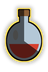

# Cooldown Overlays

See your cooldowns and potion timers right on your inventory items, with a sweep, a fill, or a countdown. Then get a nudge when it's time to drink again.

## Features

- **Cooldown sweeps** on imbued and saturated hearts, and on surge potions.
- **Effect timers** on stamina, antifire, antipoison and anti-venom, divine, goading, prayer regeneration, Menaphite remedy, and moonlight potions.
- **Boost timers** on combat, ranging, and magic potions. These count down until a stat drops below a level you choose.
- **Raid supplies**: Chambers overloads, prayer enhances, and antipoisons, plus ToA salts, liquid adrenaline, silk dressing, and blessed crystal scarabs. Nightmare Zone and blighted overloads are covered too.
- **Ready indicator** (off by default). An outline, glow, flash, or dot appears when an item is ready to use again.
- **Re-dose protection** (off by default). Left-click can become **Wait** while a timer is running. Right-click to drink, or hold Shift to use your usual Shift-click action.
- **Live preview** of your display settings, right from the config panel.

## Getting started

1. Install **Cooldown Overlays** from the Plugin Hub.
2. Drink a supported potion or use a heart. Check the matching items in your inventory for a timer.
3. Open the plugin settings to choose a display style. Each item family has its own on/off switch.

For combat potions, set a target like **Strength below** 110. The timer then shows how long until your boosted Strength drops below 110. A target of 0 turns that skill off.

## Good to know

- Timers that use the game's counters can resume after login or when you enable the plugin mid-effect. The first estimate can be off until the counter updates.
- A **?** means the duration isn't known yet. You might see it for liquid adrenaline after relogging, or for boost decay before the plugin has seen your stats drop.
- The plugin never clicks or drinks anything for you.

## More

- [Settings reference](docs/settings.md): what every option does
- [Timing details](docs/timing.md): how each timer is tracked, and how precise it is
- [Development](docs/development.md): building, running, and testing locally

Found a bug? [Open an issue](https://github.com/ggaidelevicius/runelite-cd-overlay/issues).

## License

[BSD 2-Clause](LICENSE). The ready-indicator animation is inspired by TellMeWhen's [activation border](https://github.com/ascott18/TellMeWhen/blob/master/Components/IconModules/IconModule_IconContainer/IconContainer.lua).
